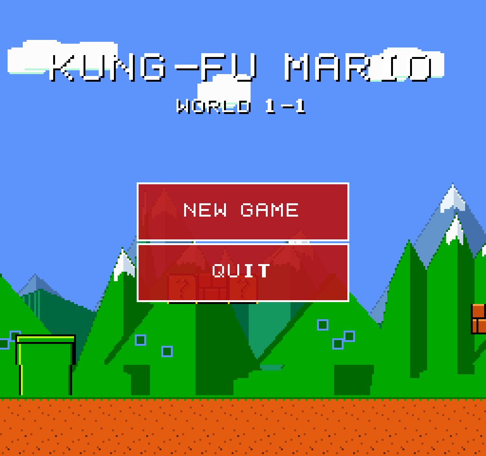
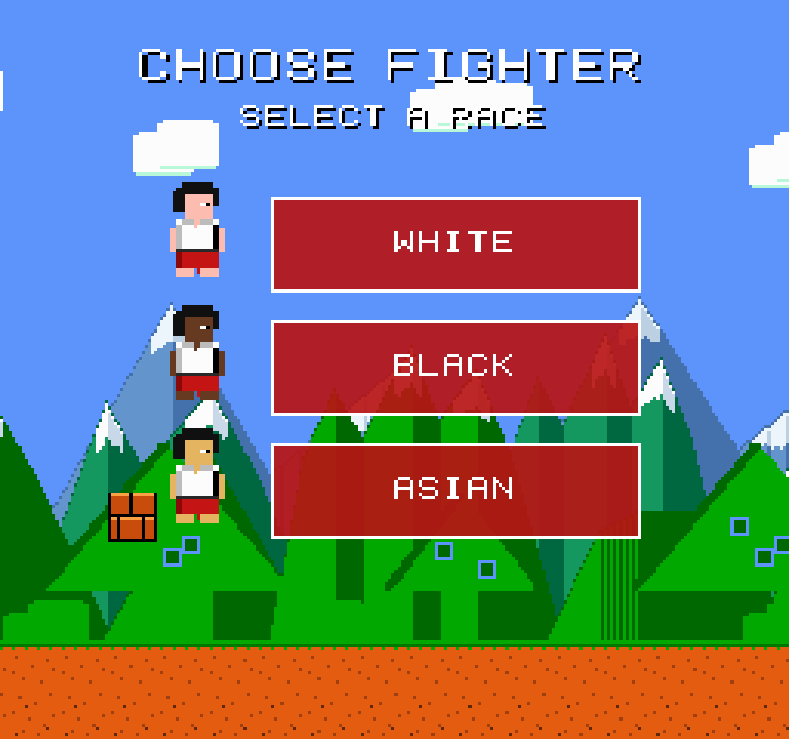
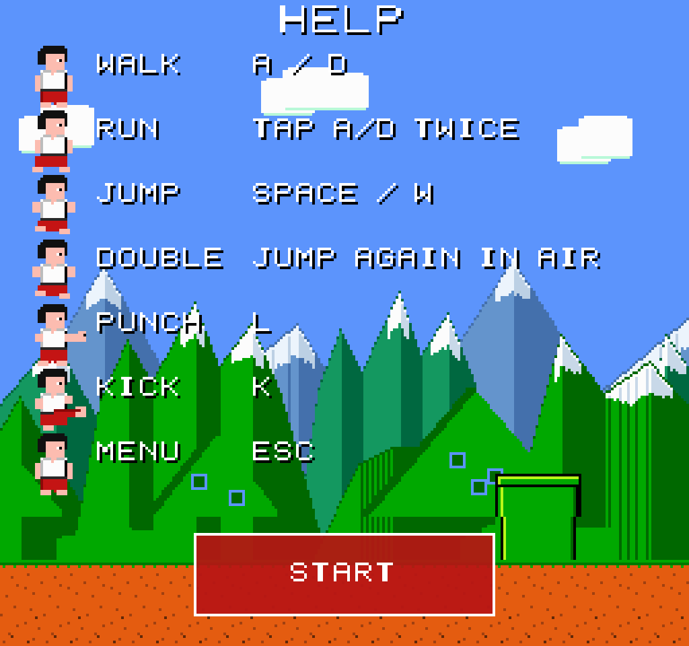
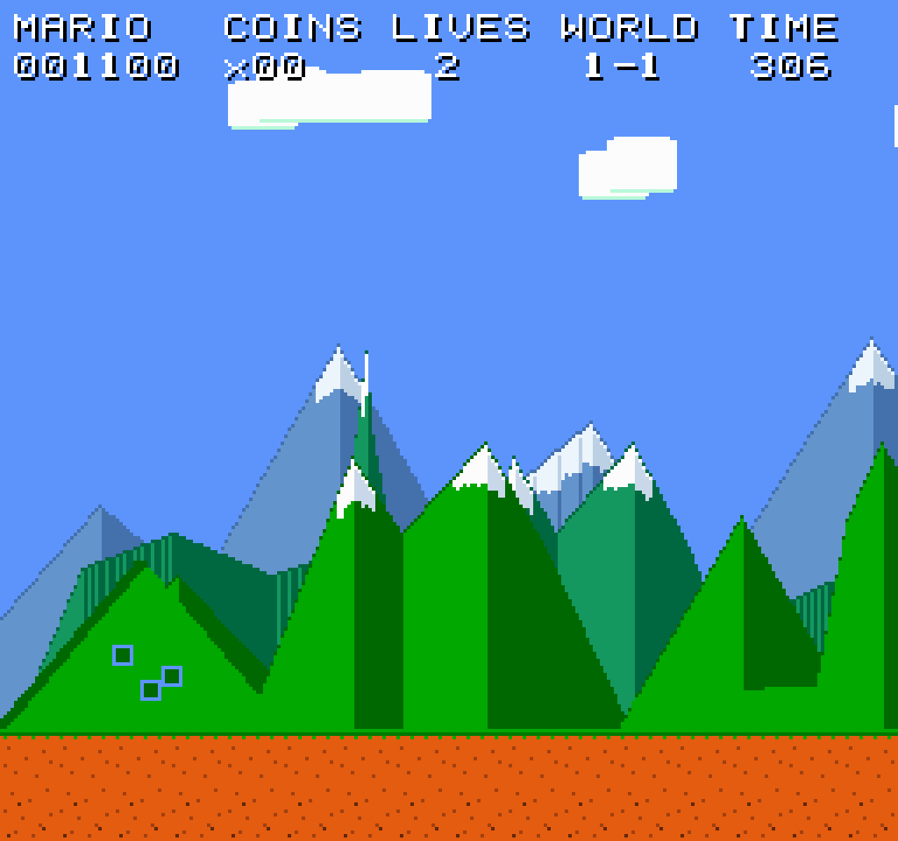
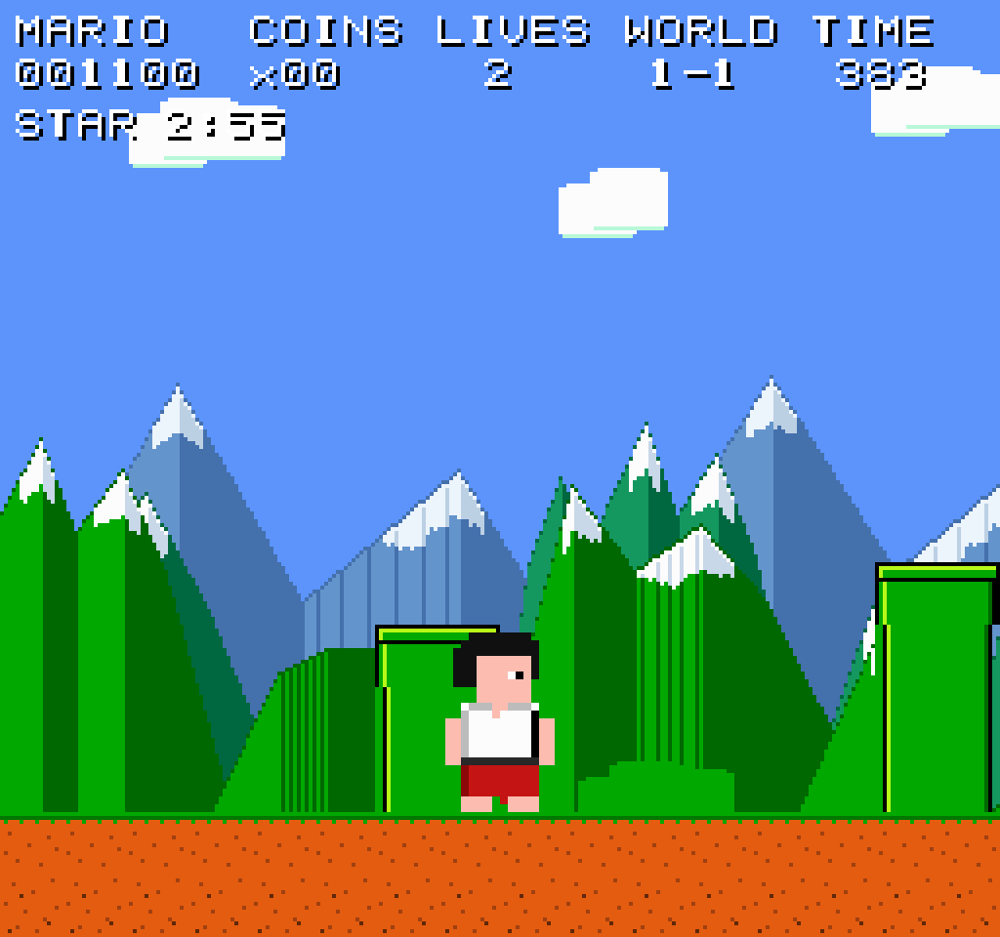
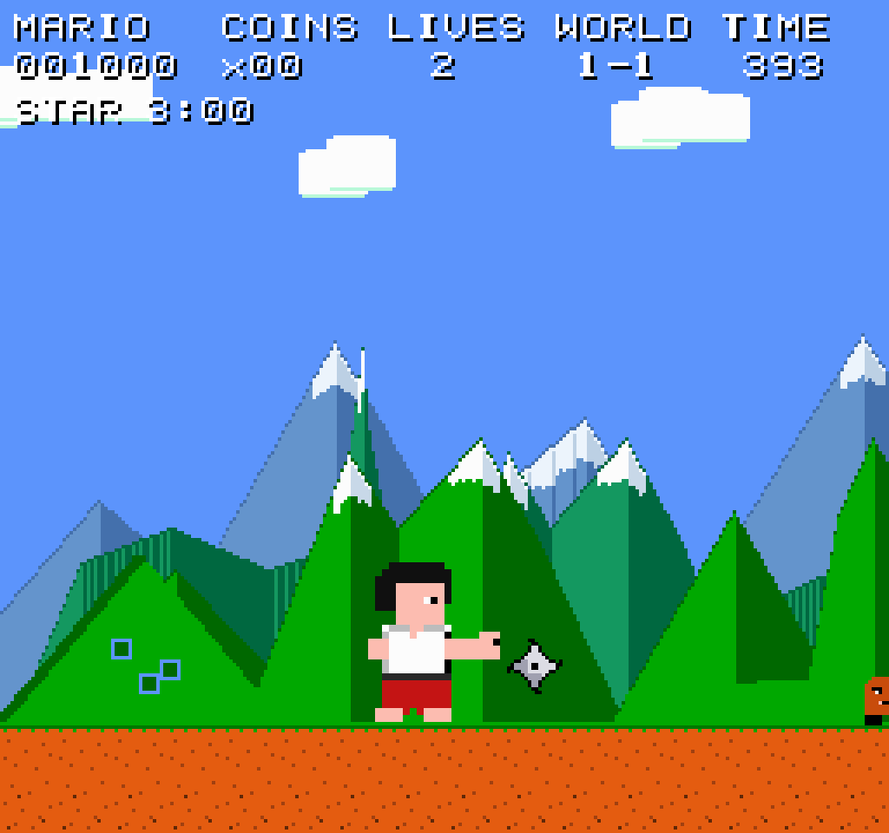
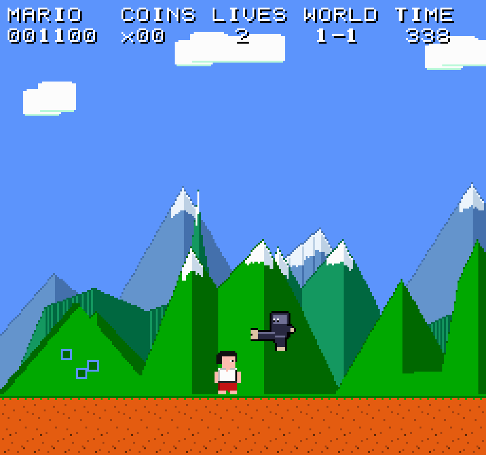

# Kung-Fu Mario

A NES-style tribute that mixes **Super Mario Bros. World 1-1** with **Kung-Fu Master (1984)** and a bit of **Bruce Lee** on the Commodore 64.

You play a kung-fu fighter in a white gi and red pants, punching, kicking, and double-jumping across a 1-1-style overworld. All pixel art and chiptune are original — not ripped from Nintendo.

DEMO at: https://kung-fu-mario.web.app/

Built in **Godot 4.7** at a native **256×240** viewport with integer scaling.

<p align="center">
  
</p>

## Screenshots

**Choose your fighter**, then a help screen before the run starts.

<p align="center">
  
  &nbsp;
  
</p>

**World 1-1** — pipes, hills, and a parallax mountain range (snow peaks in the distance, green foothills up close).

<p align="center">
  
</p>

<p align="center">
  
  &nbsp;
  
</p>

**Enemies** include classic walkers plus a C64-inspired ninja (flying jump-kick) and a green sumo named after Yamo (punches).

<p align="center">
  
</p>

## How to play

1. **New Game** on the title screen.
2. Pick a fighter: White, Black, or Asian (palette / skin swap of the same kung-fu sprite).
3. Read the help page, then **Start**.
4. Reach the flagpole at the end of World 1-1 and walk to the castle.

You have **3 lives**. At zero, **GAME OVER** appears with a button back to the main menu. **Esc** also returns to the title during a run.

### Controls

| Action | Keys |
| --- | --- |
| Walk | `A` / `D` or arrows |
| Run | Tap a direction twice, or hold `Shift` / `X` |
| Jump | `Space` / `W` / up |
| Double jump | Jump again in the air |
| Punch | `L` |
| Kick | `K` |
| Title / quit run | `Esc` |

### Power-ups

- **Mushroom** (some `?` blocks) — grow to **2×** size. Take a hit and you shrink instead of dying.
- **Shuriken** (some `?` blocks) — for **3 minutes**, every punch also throws a spinning ninja star. Timer shows as `STAR m:ss` on the HUD. Another pickup refreshes the timer; dying clears it.
- **Coins**, extra life (hidden block), star (invincibility) still appear in the 1-1 layout.

### Enemies

- Goombas and a Koopa — stomp or fight them.
- **Ninja** — closes in and does a flying jump-kick.
- **Green sumo** — slow, tanky, punches (takes more hits).

## Project layout

```
assets/     pixel font, music, sfx, sprites, tiles
scenes/     title.tscn, world_1_1.tscn
scripts/    player, level, enemies, items, HUD, …
tools/      Python generators for art, music, and the bitmap font
docs/       README screenshots
```

## Run it

1. Open the folder in **Godot 4.7**.
2. Press **Play** (`F5`). The main scene is the title screen.

Web export lives under `build/` (see `export_presets.cfg`).

## Credits

- Layout inspired by Super Mario Bros. World 1-1.
- Player look inspired by Thomas from Kung-Fu Master (1984).
- Ninja and green sumo attacks inspired by Bruce Lee (Commodore 64, 1984).
- Original 8-bit art, SFX, and music for this tribute.
